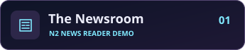
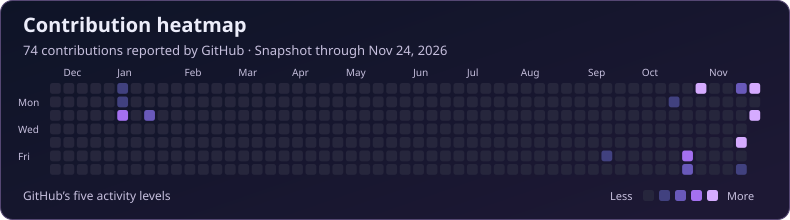

  

# Hi, I’m Khant Thu Aung

I’m an **Odoo and Python developer**. I build ERP features, automate repetitive work, and turn side projects into tools I can use myself.

[🏙 Projects](#explore-the-city) · [🧰 Tech stack](#tech-stack) · [▦ GitHub activity](#github-activity) · [🤝 Contact](#contact)

## Explore the city

[**N2 News Reader Demo**](https://github.com/khantthuaung-kta/n2-news-reader-demo) · Mobile-first Burmese news demo with topic filters, search, and a dated archive.  
`JavaScript` · `CSS` · `Node.js build`

[**TechPulse AI**](https://github.com/khantthuaung-kta/techpulse-ai) · A Telegram digest that surfaces developer news and GitHub releases.  
`Python` · `GitHub Actions` · `Telegram Bot API`

[**Movie Highlight Extractor**](https://github.com/khantthuaung-kta/movie-highlight-extractor) · A local-first CLI that spots promising clips through visual and audio signals.  
`Python` · `FFmpeg`

**Also built:** [Estate Property Management](https://github.com/khantthuaung-kta/estate_property_management) · An Odoo module based on the official estate tutorial.

## Tech stack

**ERP, backend, and automation**

**Web and mobile**

🛠 **Current focus:** Odoo modules and migrations, Python automation, and learning React + Expo for mobile apps.

## GitHub activity

[View live contributions on GitHub ↗](https://github.com/khantthuaung-kta#js-contribution-activity-description)

The language chart measures code bytes in the four linked projects, not skill levels.

## Contact

[Connect on LinkedIn](https://www.linkedin.com/in/khant-thu-aung/) · For a project-specific bug or idea, open an issue in that project’s repository.

About the artwork and data

[Still banner](./assets/neon-dev-city-still.png) · [Banner generator](./tools/render_neon_city.py) · [Card and graph generator](./tools/render_profile_cards.py)

The heatmap is a dated snapshot of GitHub’s contribution calendar. The live link above always opens the current graph.

