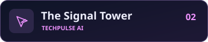
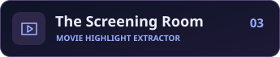

<div align="center">
  

  <h1>Hey, I'm Khant Thu Aung 👋</h1>

  <a href="https://readme-typing-svg.demolab.com">
    
  </a>

  <p>Building reliable ERP workflows, APIs, integrations, and developer-friendly tools.</p>

  <p>
    <a href="https://khantthuaung.pages.dev/en"></a>
    <a href="https://www.linkedin.com/in/khant-thu-aung/"></a>
    <a href="https://github.com/khantthuaung-kta?tab=repositories"></a>
  </p>
</div>

---

### `> whoami`

```yaml
name: Khant Thu Aung
focus: ERP systems, backend development, API integrations
building_with: Python, Odoo, PostgreSQL
exploring: React, React Native, Expo
next_chapter: Growing as a software engineer in Japan
```

- 🧩 I work on **business workflows, ERP customizations, system integrations, and migrations**.
- 🐍 I enjoy turning real-world problems into **practical Python solutions**.
- 🌱 Currently exploring **mobile development and modern web experiences**.
- 🇯🇵 Learning Japanese and working toward my long-term software engineering goals.

### `> tech --stack`

<div align="center">
  <p><strong>Backend · Data · ERP</strong></p>
  <p>
    
    &nbsp;
    <a href="https://www.odoo.com/"></a>
  </p>
  <p><strong>Web · Mobile · Workflow</strong></p>
  <p>
    
    <a href="https://expo.dev/"></a>
  </p>
</div>

### `> git log --oneline`

<div align="center">
  <a href="https://github.com/khantthuaung-kta">
    
  </a>
  <p>
    
  </p>
  <sub>These charts load live GitHub activity rather than a manually exported image. Private activity may not appear.</sub>
</div>

### `> ls ~/side-quests`

<div align="center">
  <a href="https://github.com/khantthuaung-kta/n2-news-reader-demo"></a>
  <a href="https://github.com/khantthuaung-kta/techpulse-ai"></a>
  <a href="https://github.com/khantthuaung-kta/movie-highlight-extractor"></a>
</div>

<p align="center">
  <sub>A few experiments from my GitHub. More projects live in <a href="https://github.com/khantthuaung-kta?tab=repositories">all repositories</a>.</sub>
</p>

### `> project --activity`

<!-- AUTO-PROJECT-ACTIVITY:START -->
_Public project activity sync is ready. The scheduled workflow will fill this section with real repository push dates._
<!-- AUTO-PROJECT-ACTIVITY:END -->

### `> ping khant`

<div align="center">
  <a href="https://khantthuaung.pages.dev/en"></a>
  <a href="https://www.linkedin.com/in/khant-thu-aung/"></a>
  <a href="https://github.com/khantthuaung-kta"></a>
  <p><em>Keep building. Keep learning. 🚀</em></p>
</div>

<!-- Maintenance: dynamic cards refresh externally; tech icons are hosted by skillicons.dev; artwork stays in ./assets. Add future work to GitHub repos without editing a static contribution graph. -->
