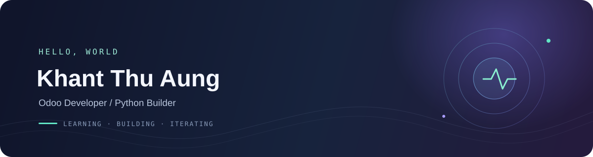

  
   
  <strong>Odoo Developer · Python Builder · Exploring React & Mobile Integration</strong>
   
  Yangon, Myanmar · Building practical software with thoughtful details
    
  <a href="https://github.com/khantthuaung-kta?tab=repositories">Explore my repositories</a>

---

### မင်္ဂလာပါ — I'm Khant Thu Aung

I work with **Odoo and Python**, and I'm expanding into **React and mobile integration**. I enjoy turning useful ideas into approachable tools—from business workflows to small, focused developer utilities.

### What I'm building

| Project | What it does |
| --- | --- |
| [**TechPulse AI**](https://github.com/khantthuaung-kta/techpulse-ai) | A daily Telegram tech digest that ranks developer news and GitHub releases, with optional Burmese summaries. |
| [**Movie Highlight Extractor**](https://github.com/khantthuaung-kta/movie-highlight-extractor) | A local-first Python CLI that finds candidate movie highlights using visual and audio signals. |
| [**N2 News Reader**](https://github.com/khantthuaung-kta/n2-news-reader-demo) | A mobile-first Burmese news reader demo with archive search and featured picks. |
| [**Estate Property Management**](https://github.com/khantthuaung-kta/estate_property_management) | An Odoo property-management project based on the Odoo estate tutorial. |

### Tools I use & explore

  
  
  
  
  

### A little more

- **Current focus:** Odoo development, Python automation, and learning React/mobile integration.
- **Approach:** Build useful things, keep them understandable, and improve them one iteration at a time.

  Thanks for stopping by — ကျေးဇူးတင်ပါတယ် ✨

