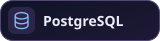
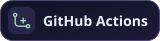
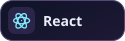
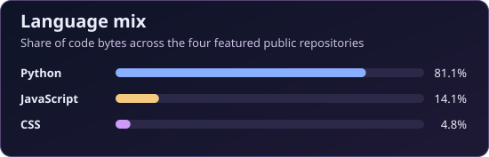

  

  <h1>Khant Thu Aung</h1>
  
<strong>Odoo Developer · Python Builder</strong>

  
I build practical ERP features, migrations, and automation. Currently exploring React and Expo for mobile apps.

  

    <a href="https://khantthuaung.pages.dev/en">Portfolio</a>
    &nbsp;·&nbsp;
    <a href="https://www.linkedin.com/in/khant-thu-aung/">LinkedIn</a>
    &nbsp;·&nbsp;
    <a href="https://github.com/khantthuaung-kta?tab=repositories">Explore my projects</a>
  

## Featured projects

  
  
  

## Tools I use

  
  
  
  
   
  
  
  

## Code snapshot

  

  <a href="https://github.com/khantthuaung-kta#js-contribution-activity-description">GitHub contribution activity</a>
  &nbsp;·&nbsp;
  <a href="https://github.com/khantthuaung-kta?tab=repositories">All repositories</a>

<!-- Repositories and the contribution calendar are managed by GitHub. No project list, graph export, or scheduled job to maintain here. -->

Portfolio artwork

[Still banner](./assets/neon-dev-city-still.png) · [Banner source](./tools/render_neon_city.py)

