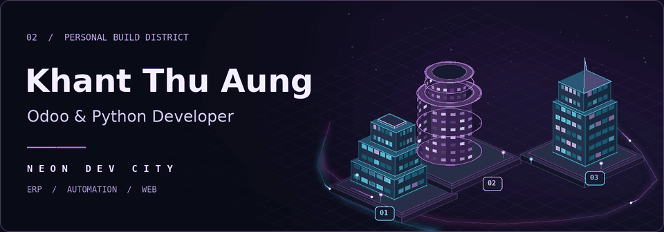

  

I’m **Khant Thu Aung**, an Odoo and Python developer. I build ERP features, automate repetitive work, and turn side projects into tools I can use myself.

## Explore the city

| District | Project | What it does |
| :-- | :-- | :-- |
| **01 · The Newsroom** | [N2 News Reader Demo](https://github.com/khantthuaung-kta/n2-news-reader-demo) | A mobile-first Burmese news reader demo with search, topic filters, and a dated archive. |
| **02 · The Signal Tower** | [TechPulse AI](https://github.com/khantthuaung-kta/techpulse-ai) | A Telegram digest that surfaces developer news and GitHub releases. |
| **03 · The Screening Room** | [Movie Highlight Extractor](https://github.com/khantthuaung-kta/movie-highlight-extractor) | A local Python CLI that finds promising clips using visual and audio signals. |

**Also built:** [Estate Property Management](https://github.com/khantthuaung-kta/estate_property_management), an Odoo project based on the official estate tutorial.

## What I’m building now

- **Work:** Odoo modules, migrations, and Python automation.
- **Learning:** React and Expo for mobile apps, plus Japanese outside of code.
- **Toolkit:** Odoo · Python · PostgreSQL · JavaScript · GitHub Actions.

[Browse my repositories](https://github.com/khantthuaung-kta?tab=repositories) · [Still version of the banner](./assets/neon-dev-city-still.png) · [Banner source](./tools/render_neon_city.py)
